<p align="center">
  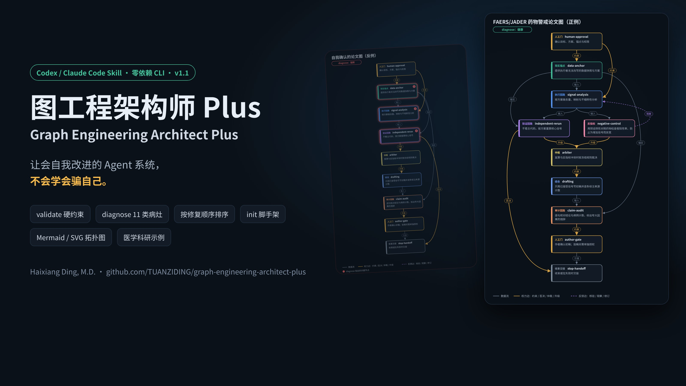
</p>

<h1 align="center">图工程架构师 Plus<br>Graph Engineering Architect Plus</h1>

<p align="center">
  <strong>让会自我改进的 Agent 系统，不会学会骗自己。把“谁能约束谁、谁拿着优化者碰不到的证据”写成一张可校验的图，自动找出刷分、循环互证、看守剧场、元回路劫持等结构漏洞，并按修复顺序给出修法。</strong><br>
  Design self-improving agent systems that do not learn to fool themselves: a Codex / Claude Code skill plus a zero-dependency CLI that validates, diagnoses and repair-orders graphs of interacting loops.
</p>

<h3 align="center">
  <a href="https://tuanziding.github.io/graph-engineering-architect-plus/">▶ 打开项目主页 · Open the project page</a>
</h3>

<p align="center">
  <a href="README.md">简体中文</a> · <a href="文档/英文说明v1.0.md">English</a>
</p>

<p align="center">
  <a href="https://github.com/TUANZIDING/graph-engineering-architect-plus/actions"></a>
  
  <a href="LICENSE"></a>
  
  
</p>

<p align="center">
  <code>validate 硬约束</code> · <code>diagnose 11 类病灶</code> · <code>按修复顺序排序</code> · <code>init 脚手架</code> · <code>SVG / Mermaid 拓扑图</code> · <code>兼容 version: 1 旧格式</code> · <code>药物警戒与病历质控示例</code> · <code>32 + 21 个回归测试</code>
</p>

<p align="center">
  <a href="#why">为什么</a> ｜ <a href="#patterns">11 类病灶</a> ｜ <a href="#showcase">示例对照</a> ｜ <a href="#repair">修复顺序</a> ｜ <a href="#rules">硬约束</a> ｜ <a href="#quick-start">快速开始</a> ｜ <a href="#contents">仓库内容</a> ｜ <a href="#license">版权与许可</a>
</p>

> ⚠️ 结构校验只证明契约完整，不证明领域结论真实、锚点在现实中独立或任务已完成。投稿、推送、发布、删除等外部动作必须单独授权。示例中的药物、病历与人员均为示意，不含真实患者数据。

---

<a id="why"></a>

## 为什么需要它 · Why

单个回路只看得见自己的指标：它分不清“指标变好”和“结果变好”，也看不见自己的目标是否对。加更多 Agent、更多轮重试，往往只是让同一个偏差被更多人确认。

| 原则 | 含义 | 对应检查 |
| --- | --- | --- |
| **扎根** | 至少一份证据是优化者生成不了、改不了、藏不住的；验证者必须拿到它 | E-ANCHORWRITE、E-VNOANCHOR、E-CIRCULAR、E-THEATER |
| **权力** | 可靠性来自谁能约束、否决、升级、仲裁谁，而不是箭头多少 | E-VNOTEETH、E-ARBITER、E-DECORATIVE、E-METACAPTURE |
| **分层** | 快回路在边界内动作，慢回路审目标与口径，根判断归人 | E-CADENCE、E-GATE、O-GOAL |

<a id="patterns"></a>

## 自动识别 11 类病灶 · 11 pathologies

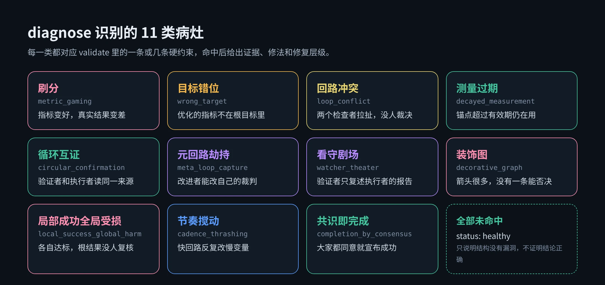

<sub>每一类都对应 validate 里的一条或几条硬约束；命中后给出证据、修法和修复层级。全部未命中只说明结构没有漏洞，不证明结论正确。</sub>

<a id="showcase"></a>

## 示例对照 · Showcase

[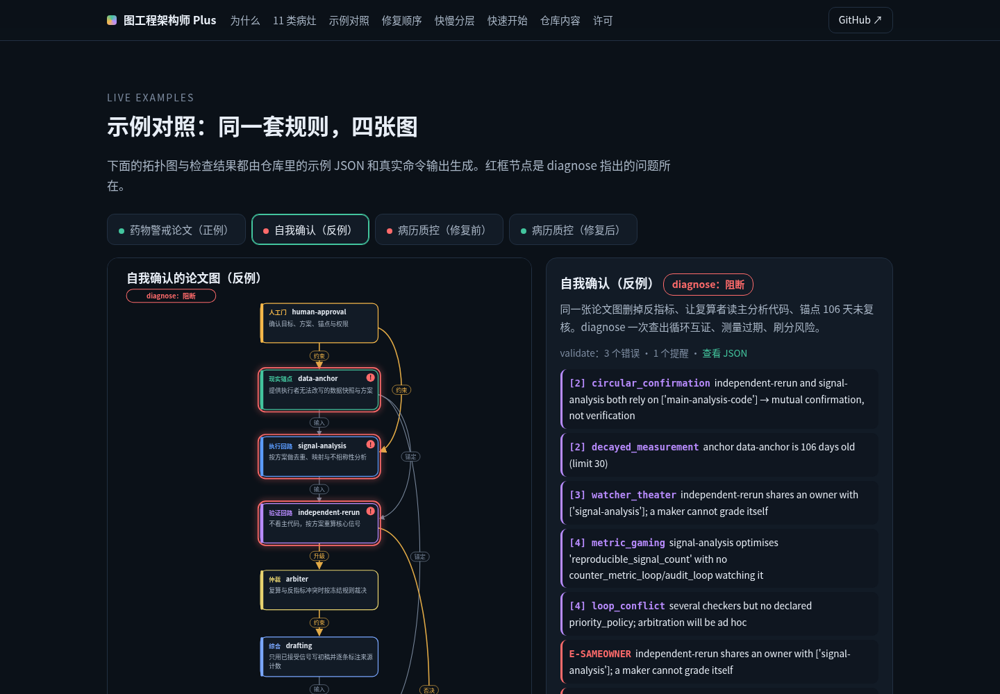](https://tuanziding.github.io/graph-engineering-architect-plus/#lab)

<sub>项目主页 1440 px：同一套规则跑四张图，红框节点是 diagnose 指出的问题所在。</sub>

| 正例：药物警戒论文图 | 反例：自我确认 |
| --- | --- |
| 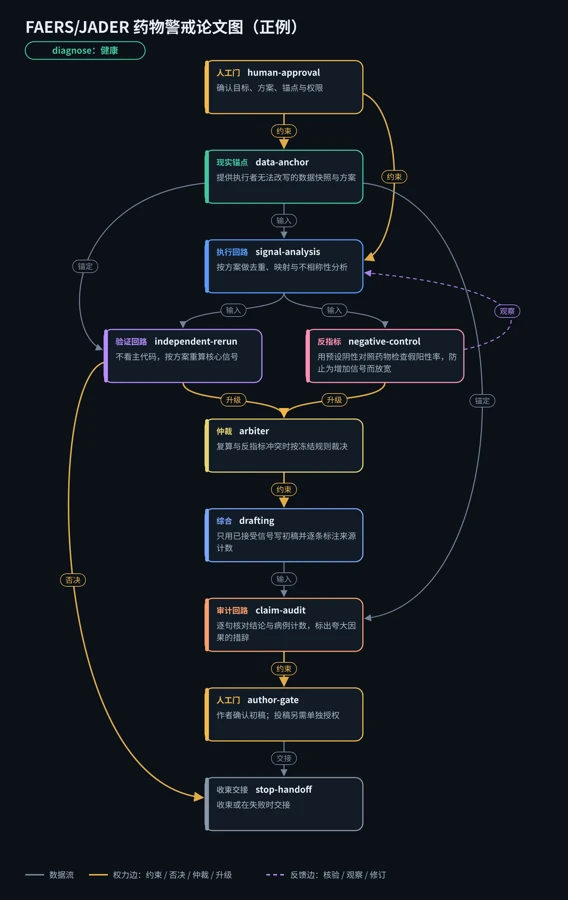 | 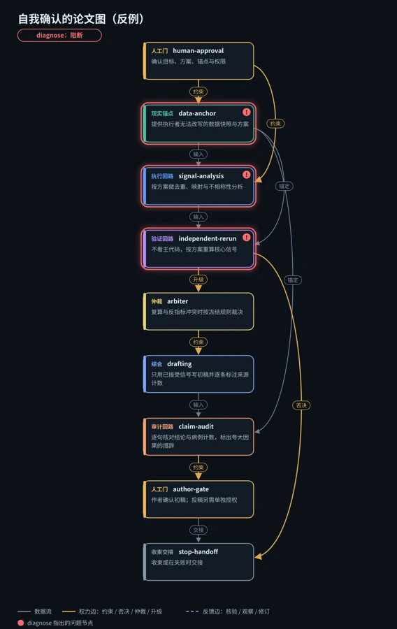 |
| 复算者不看主代码、只拿冻结快照；阴性对照盯住假阳性；仲裁优先级写明 | 删掉反指标、复算者读主代码、同一 owner 自评、锚点 106 天未复核 |

| 病历质控：修复前 | 病历质控：修复后 |
| --- | --- |
| 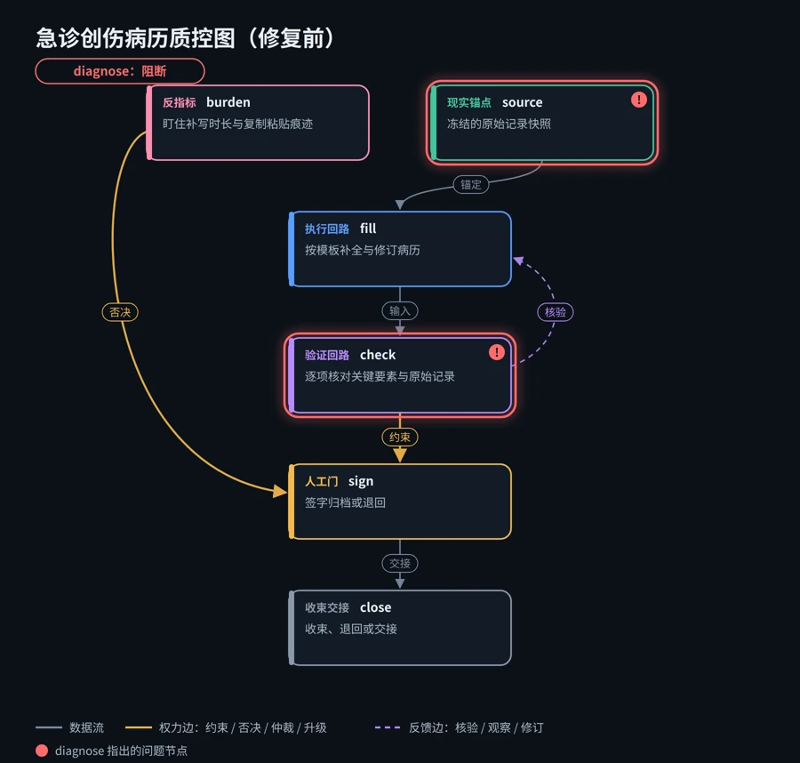 | 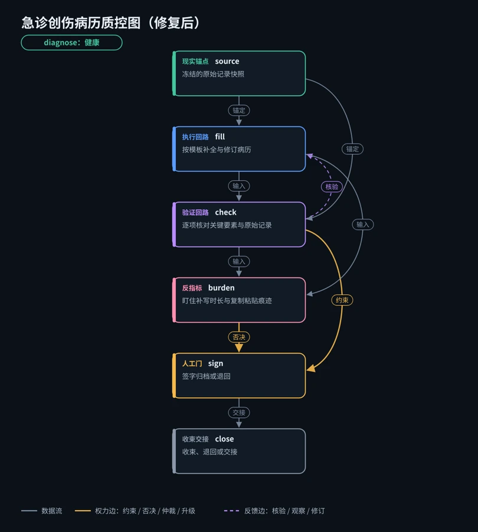 |
| 字段齐全，但锚点只连书写医生，质控员拿不到原始记录；补写 ↔ 核对没有轮数上限 | 加 3 条边与轮数上限、锚点有效期，validate 与 diagnose 都通过 |

| 手机 · 首页 | 手机 · 示例对照 |
| --- | --- |
| <a href="https://tuanziding.github.io/graph-engineering-architect-plus/">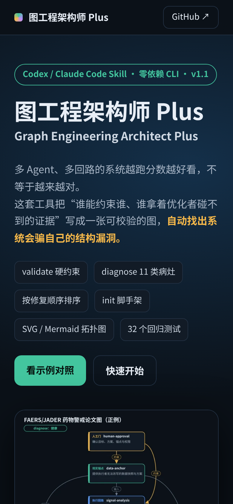</a> | <a href="https://tuanziding.github.io/graph-engineering-architect-plus/#lab">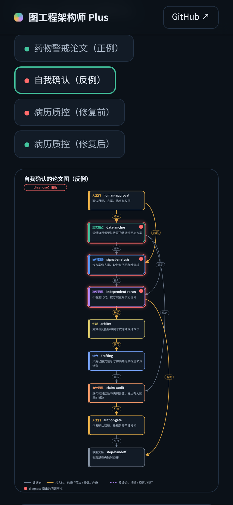</a> |

<sub>真实截图：无头 Chromium 渲染 index.html（桌面 1440 px，手机 390 px @2x）。拓扑图由 <code>工具/绘制拓扑图v1.0.py</code> 从示例 JSON 生成，详见 <a href="文档/图片说明v1.0.md">图片说明</a>。</sub>

<a id="repair"></a>

## 修复顺序与快慢分层 · Repair order & cadence

| 从底层修起 | 快慢分层 |
| --- | --- |
| 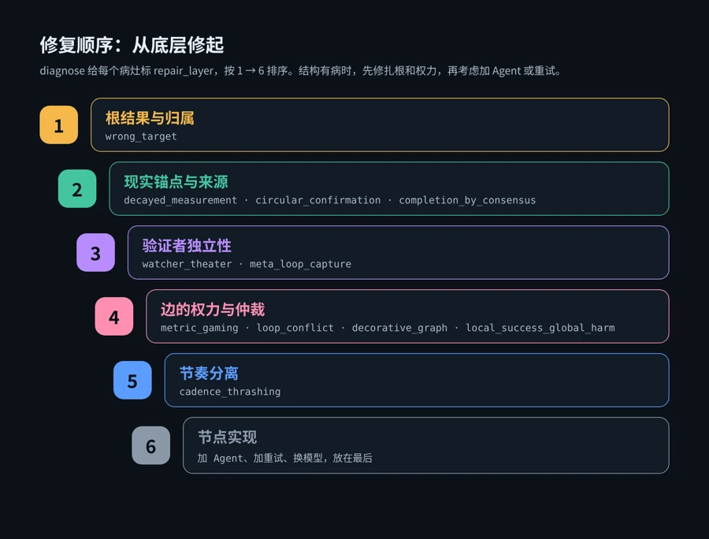 | 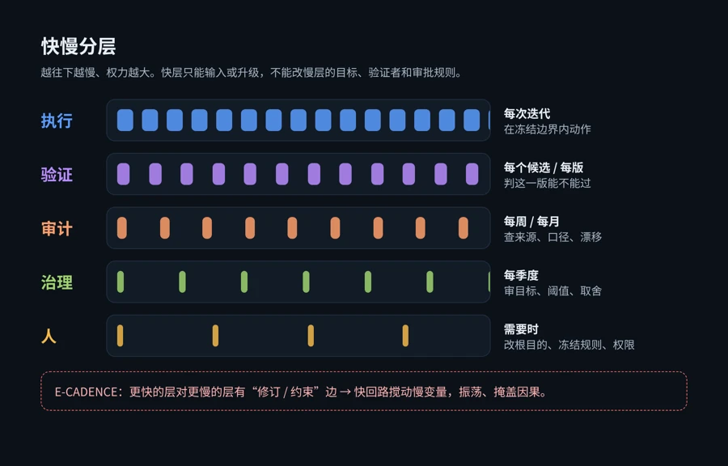 |
| diagnose 按 repair_layer 排序：根结果 → 锚点 → 验证独立性 → 边的权力 → 节奏 → 实现。先修扎根和权力，再考虑加 Agent 或重试 | 更快的节点对更慢的节点有“修订 / 约束”边 → E-CADENCE；执行者能修订验证、锚点、审计、治理节点 → E-METACAPTURE |

<a id="rules"></a>

## 硬约束一览 · Rules

| 类别 | 规则 |
| --- | --- |
| 扎根 | 锚点写保护 · 验证者必须拿到锚点 · 共享来源循环互证 · 看守剧场 · 锚点有效期（max_age_days + last_confirmed） |
| 权力 | 验证者必须有否决权 · 制造者不能自评 · 多检查者需仲裁与优先级 · 至少一条权力边 · 元回路劫持 |
| 防刷分 | 被优化的指标必须配反指标 · 必须有反指标或审计回路 · 至少两种回路 |
| 分层与人 | 快慢节奏 · 高风险副作用前置人工门 · 目标变更须人工批准 |
| 拓扑 | 有界环与出口 · 每个节点可收束 · 并行单写者 · 汇合完整 · 无 TODO 残留 |

完整字段见 [`文档/规格说明v1.2.md`](文档/规格说明v1.2.md)，领域必需的效度检查见 [`文档/领域效度清单v1.2.md`](文档/领域效度清单v1.2.md)，每条规则背后的理由见 [`文档/设计手册v1.0.md`](文档/设计手册v1.0.md)。

<a id="quick-start"></a>

## 快速开始 · Quick start

```bash
git clone https://github.com/TUANZIDING/graph-engineering-architect-plus.git
cd graph-engineering-architect-plus

# 安装为 Skill
cp -R 工具/graph-engineering-architect-plus ~/.codex/skills/      # Codex
cp -R 工具/graph-engineering-architect-plus ~/.claude/skills/     # Claude Code

# 命令行（Python 3.10+，零依赖）
T=工具/graph-engineering-architect-plus/scripts/geaplus-v1.2.py
python3 $T init "可复现的结论" --root . --slug demo     # 生成 .graph/demo/ 四件套
python3 $T validate .graph/demo                          # TODO 没填完会失败
python3 $T diagnose 示例/broken-circular-graph-v1.0.json --today 2026-11-15
python3 $T mermaid  示例/faers-manuscript-graph-v1.1.json
python3 工具/绘制拓扑图v1.0.py 示例/faers-manuscript-graph-v1.1.json out.svg --title 我的图

# 项目检查（测试 + 示例状态 + 命名 + 链接）
python3 验证/项目检查v1.0.py
```

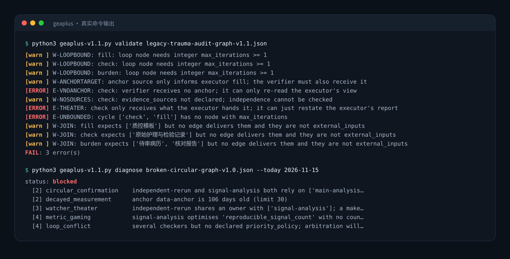

<a id="contents"></a>

## 仓库内容 · Contents

| 路径 | 内容 |
| --- | --- |
| [`工具/graph-engineering-architect-plus/`](工具/graph-engineering-architect-plus/) | 可安装的 Skill：`SKILL.md`、`scripts/geaplus-v1.2.py`（v1.0、v1.1 保留）、`references/` |
| [`工具/`](工具/) | `绘制拓扑图v1.0.py` · `渲染图片v1.0.py` · `制作配图v1.0.py` · `构建网页数据v1.0.py` |
| [`示例/`](示例/) | 药物警戒论文正例与反例、急诊病历质控修复前后，附 Mermaid 与 [示例说明](示例/示例说明v1.0.md) |
| [`文档/`](文档/) | 设计手册、规格说明、英文说明、图片说明、封面与截图 |
| [`图片/`](图片/) | 拓扑图（SVG + webp + 缩略图）与示意图 |
| [`验证/`](验证/) | 回归测试 v1.0（21）、v1.1（35）与 v1.2（44）、项目检查、[运行记录](验证/运行记录v1.1.md) |
| `index.html` · `assets/` | GitHub Pages 项目主页 |

<a id="license"></a>

## 版权与许可 · License

- 代码、文档与图片：[MIT](LICENSE) © 2026 Haixiang Ding, M.D.
- 致谢：设计思路受 Anita Yin 的 graph-engineering-architect 启发；不变量思想参考 [luxiaolei/graph-engineering](https://github.com/luxiaolei/graph-engineering)（Apache-2.0）。本仓库代码、文档与示例为独立编写。
- 引用：见 [`CITATION.cff`](CITATION.cff)。
