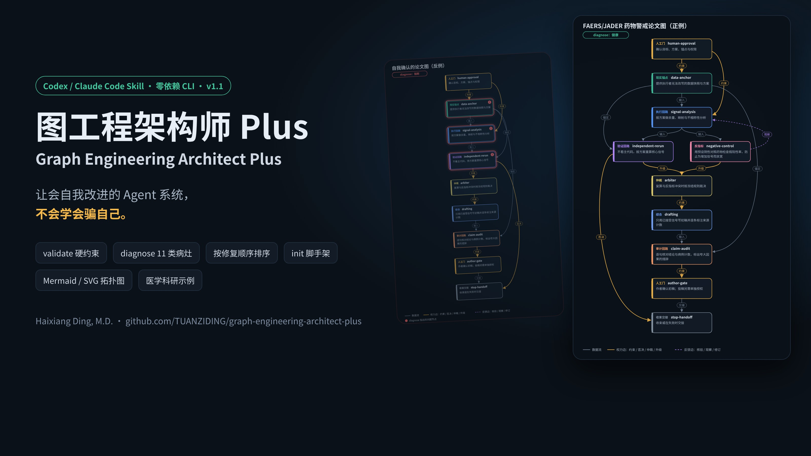

<p align="center">
  
</p>

<h1 align="center">Graph Engineering Architect Plus</h1>

<p align="center"><strong>Design self-improving agent systems that do not learn to fool themselves.</strong></p>

<p align="center">
  <a href="../README.md">简体中文</a> · <a href="英文说明v1.0.md">English</a> · <a href="https://tuanziding.github.io/graph-engineering-architect-plus/">Project page</a>
</p>

A Codex / Claude Code skill plus a zero-dependency Python CLI. You describe a multi-loop system (executors, verifiers, counter-metrics, audits, arbitration, human gates, anchors) as a graph; the tool checks whether the graph can deceive itself and tells you what to repair first.

## What it does

| Command | Purpose |
| --- | --- |
| `validate` | Hard structural rules: write-protected anchors, verifiers that receive an anchor and hold a veto, makers never grade themselves, no shared-provenance circularity, every optimised metric paired with a counter-metric, arbitration for multiple checkers, human gate before high-risk side effects, bounded cycles with exits, reachable terminal, single writer, complete joins. v1.1 adds: counter-metric/audit required, decorative graph, meta-loop capture, cadence thrashing, watcher theater, priority policy, leftover TODOs. |
| `diagnose` | Detects 11 pathologies (metric gaming, wrong target, loop conflict, decayed measurement, circular confirmation, meta-loop capture, decorative graph, cadence thrashing, local success with global harm, watcher theater, completion by consensus) and sorts them by repair layer. |
| `init` | Scaffolds `.graph/<slug>/` (graph.json, graph-spec.md, validation-report.md, handoff.md); placeholders fail validation until filled. |
| `simulate` | Topological batch simulation with feedback edges separated from scheduling; never claims domain completion. |
| `mermaid` | Mermaid export. `工具/绘制拓扑图v1.0.py` renders a layered SVG with flagged nodes. |
| `classify` | Conservative direct / loop / graph decision. |

It also reads the older `version: 1` schema and the 1.0 spec field names.

## Repair order

Fix the lowest broken layer first: root outcome & ownership → reality anchors & provenance → verifier independence → edge authority & arbitration → cadence separation → node implementation. Do not add agents or retries before grounding and authority are repaired.

## Quick start

```bash
cp -R 工具/graph-engineering-architect-plus ~/.codex/skills/
T=工具/graph-engineering-architect-plus/scripts/geaplus-v1.1.py
python3 $T diagnose 示例/broken-circular-graph-v1.0.json --today 2026-11-15
python3 验证/项目检查v1.0.py
```

## Limits

Structural validation proves the contract is complete. It does not prove the domain conclusion is true, that an anchor is independent in the real world, or that the task is done. External actions (submission, push, publication, deletion) need separate approval.

## License and acknowledgement

MIT © 2026 Haixiang Ding, M.D. Design ideas inspired by Anita Yin's graph-engineering-architect; invariant ideas from luxiaolei/graph-engineering (Apache-2.0). Code, docs and examples in this repository were written independently.
